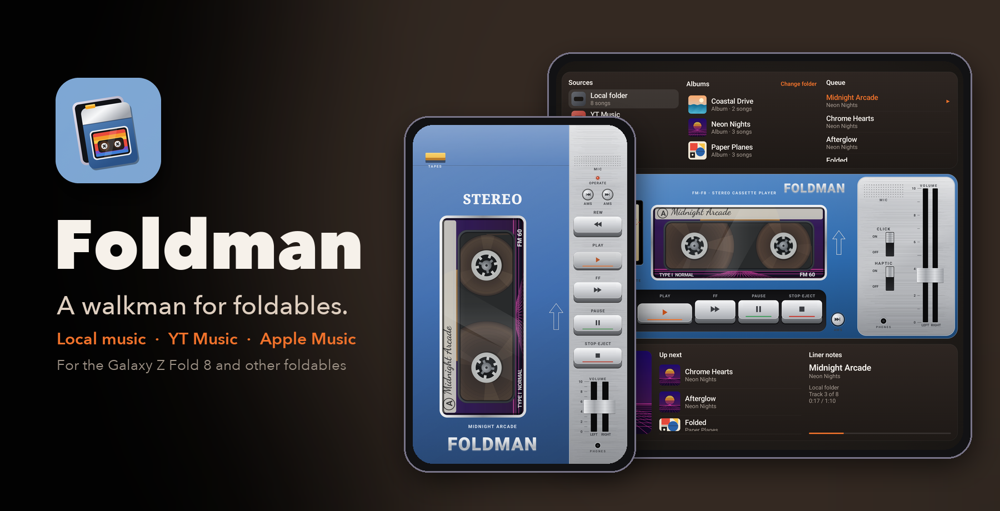
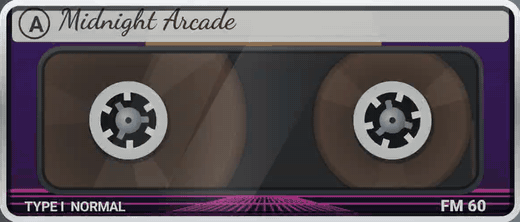
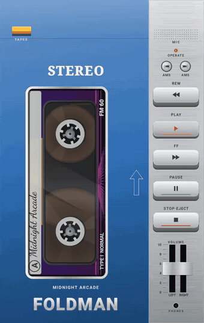
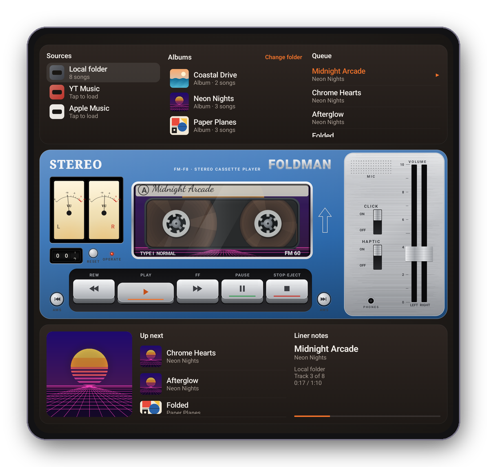
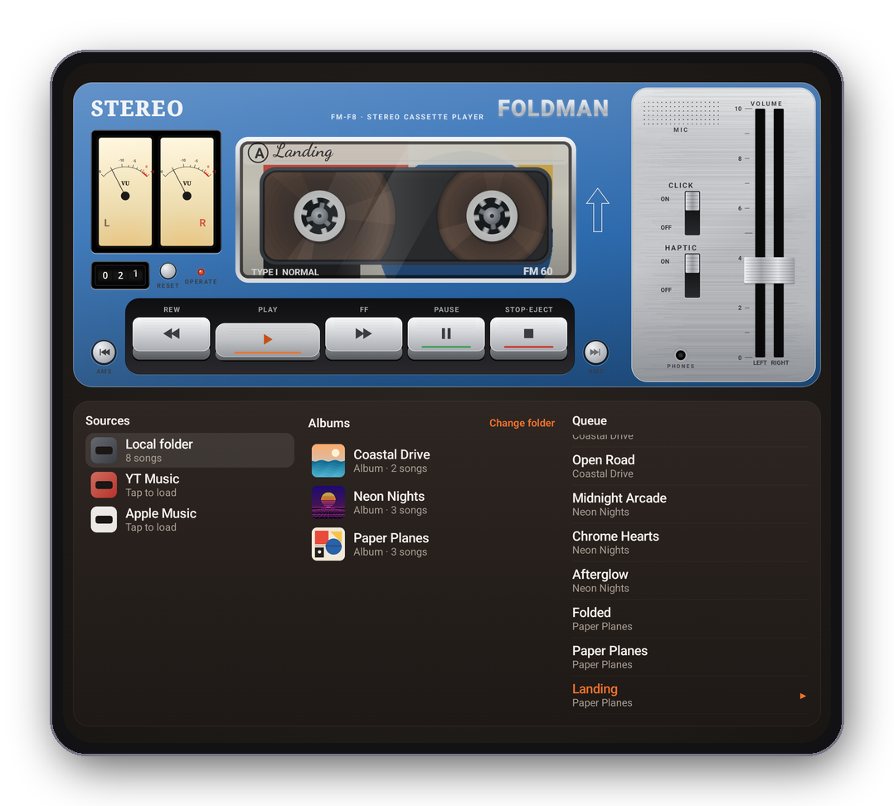
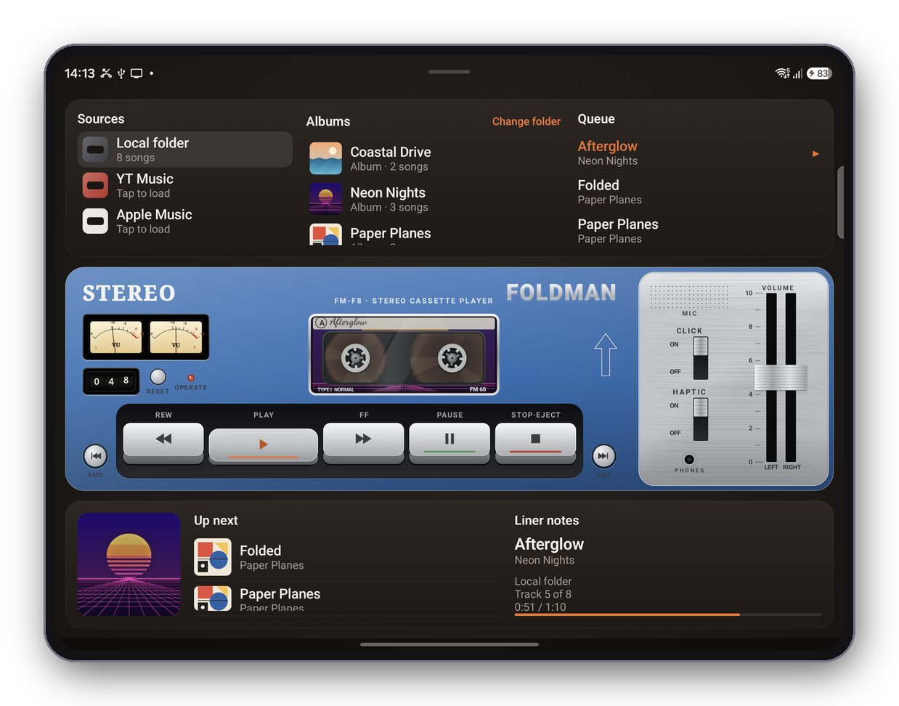
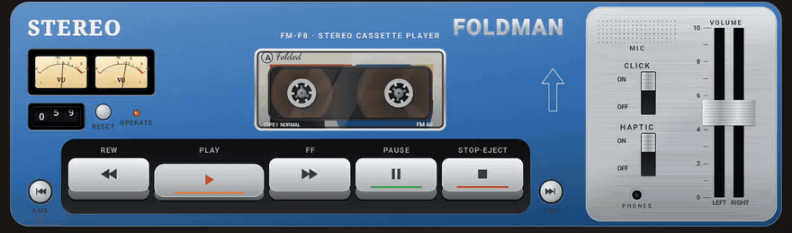

<p align="center">
  
</p>

<p align="center">
  <a href="https://github.com/deveshrai/Foldman/releases/latest"></a>
  <a href="LICENSE"></a>
  
  
</p>

<p align="center"><b>Foldman turns a folding phone into a cassette player.</b><br>
Folded, it's a portable player in your hand. Unfold it and it lays down into a deck.<br>
Play local music, sign in to YouTube Music and play it inside Foldman, or subscribe to podcast RSS feeds — all from real piano keys.</p>

<p align="center">
  <a href="https://github.com/deveshrai/Foldman/wiki"><b>📖 Wiki</b></a> ·
  <a href="https://github.com/deveshrai/Foldman/wiki/Using-Foldman">Using Foldman</a> ·
  <a href="https://github.com/deveshrai/Foldman/wiki/Troubleshooting">Troubleshooting</a> ·
  <a href="CHANGELOG.md">Changelog</a> ·
  <a href="PRIVACY.md">Privacy</a> ·
  <a href="CONTRIBUTING.md">Contributing</a>
</p>

---

<p align="center">
  
</p>

## The tape moves the way the keys say

Every key is a latching mechanism, and the cassette behind the window follows it, frame by frame.

| Key | What the mechanism does | What you see |
| --- | --- | --- |
| **PLAY** | Latches down, tape runs at 4.76 cm/s | Reels turn at speed ÷ radius: the nearly empty reel spins fast, the full one slowly, and they swap as the song plays. OPERATE LED on. Counter rolls. |
| **PAUSE** | Latches with PLAY still down | Reels hold still. LED blinks slowly. |
| **STOP·EJECT** | Releases everything | Reels coast to a stop. LED off. Press again with the tape stopped and the cassette pops. |
| **FF / REW** | Latches and winds at 12× | Reels spin up with inertia to a motion-blurred blur, the counter races, the LED flickers. The tape winds straight through into the next or previous song, and the auto-stop thunks at the end of the tape. |
| **AMS ⏮ ⏭** | Skips to the previous or next song | |

The keys click (the sounds are synthesised, not samples) and buzz under your thumb. The tape counter is geared to the take-up reel, the VU needles follow the real audio on local files, and the tape packs on the reels show how far through the song you are.

## Folded, unfolded, half-open

Foldman reads the hinge and rebuilds itself for each posture, without stopping the music.

<table>
  <tr>
    <td align="center" width="34%"><br><b>Folded</b><br><sub>An upright portable in blue enamel, edge to edge. The tape stands on end behind a small window; keys, volume and phones socket run down the silver side strip.</sub></td>
    <td align="center" width="66%"><br><b>Unfolded</b><br><sub>The player lies down as a deck: twin VU meters, a mechanical counter, CLICK and HAPTIC switches. Your library is above it, and the cover, up next and liner notes are below.</sub></td>
  </tr>
</table>

<table>
  <tr>
    <td align="center" width="50%"><br><b>Half-open (Flex mode)</b><br><sub>Stand it on a table: the deck takes the top half, the library the bottom.</sub></td>
    <td align="center" width="50%"><br><b>Unfolded, landscape</b><br><sub>On a real Z Fold 8.</sub></td>
  </tr>
</table>

<p align="center">
  
  <br><sub>The deck on a real Z Fold 8: needles swinging, the counter rolling, FF winding the tape on.</sub>
</p>

## Four ways to load a tape

| | Source | How it works |
| --- | --- | --- |
| 🗂 | **Local folder** | Pick any folder on the phone. MP3, FLAC, M4A, OGG, Opus, WAV and more play through Media3 in the background, with the system media controls and headphone keys. Album art comes from the files' embedded art or a `cover.jpg` / `folder.png` beside them, and each sub-folder becomes an album. |
| ▶️ | **YouTube Music** | Sign in, search, browse your playlists and stream songs directly in Foldman. Playback, the queue and cassette controls all stay in the app. |
| 📻 | **Podcasts** | Subscribe to any podcast RSS feed by pasting its URL, browse episodes per show, and play them right in the deck. |

The album art is printed on the cassette label, so you only see it around the reels, the way you would on a real tape. Its colours also tint the paper strip with the handwritten title.

## Install

1. Download the **`Foldman-…-release.apk`** from the [latest release](https://github.com/deveshrai/Foldman/releases/latest) and open it on your phone. You'll need to allow installs from your browser or file manager.
2. **For YouTube Music:** choose **YouTube Music** in Foldman, sign in from the library panel, then search for a song or open one of your playlists. Tap a song to play it directly in Foldman.
3. **For podcasts:** choose **Podcasts**, tap **Add**, and paste the show's RSS feed URL.

Works on Android 11 and later, on 64-bit ARM phones. It's designed for the Galaxy Z Fold 8 and runs on any foldable or regular phone. Samsung's **Auto Blocker** can stop sideloaded installs, so switch it off in Settings → Security and privacy if the install is refused.

## Build from source

```bash
git clone https://github.com/deveshrai/Foldman.git
cd Foldman
./gradlew :app:assembleDebug
```

You'll need JDK 17+, the Android SDK (compile SDK 37), and an internet connection for the bundled YouTube Music/NewPipe dependencies. The APK lands in `app/build/outputs/apk/debug/`. Local files, YouTube Music and podcasts all work out of the box.

Release builds, signing and version numbers are covered in [Release process](https://github.com/deveshrai/Foldman/wiki/Release-process).

## How it's put together

```mermaid
flowchart LR
    subgraph UI["Jetpack Compose UI"]
        Screen["FoldmanScreen<br/>posture from the hinge"] --> Deck["Cassette · Keys · Gauges<br/>Canvas-drawn, physics-driven"]
        Screen --> Panels["Library · Now playing · Tape shelf"]
    end
    VM["DeckViewModel<br/>transport state machine<br/>REW/FF winding"] --> Screen
    VM --> Local["LocalBackend<br/>Media3 controller"]
    VM --> YTBrowser["Foldman YouTube Music browser<br/>sign-in · search · playlists"]
    VM --> Podcasts["Podcasts browser<br/>RSS feeds · episodes"]
    Podcasts --> KodaService    VM --> YTBackend["YouTubeMusicBackend<br/>MediaBrowser"]
    Local --> Service["PlaybackService<br/>ExoPlayer + media notification"]
    YTBrowser --> YouTube["YouTube Music"]
    YTBackend --> KodaService["Bundled playback service<br/>MediaLibraryService + ExoPlayer"]
```

- **[`ui/ReelMotion.kt`](app/src/main/java/dev/foldman/ui/ReelMotion.kt):** the tape transport as a small physics model. Tape speed is constant, so each reel turns at *v ÷ r*; pack radii follow conservation of tape area, and the reels spin up and coast down.
- **[`ui/Cassette.kt`](app/src/main/java/dev/foldman/ui/Cassette.kt):** the cassette, drawn in millimetres to the real 100.4 × 63.8 mm Compact Cassette and seen through the case window.
- **[`deck/DeckViewModel.kt`](app/src/main/java/dev/foldman/deck/DeckViewModel.kt):** keys → transport state (stop vs. pause latches, winding through songs, auto-stop).
- **[`art/icon.svg`](art/icon.svg):** the launcher icon's source. Run `python3 tools/svg_to_icon.py` to regenerate the adaptive and themed icon layers.

## Known limitations

- **Another app taking over the audio stops Foldman.** Press PLAY in Foldman to take the audio back.
- **YouTube Music:** Foldman uses unofficial YouTube interfaces and stream resolution, not an official Google playback SDK. Google may change or restrict these interfaces; account sign-in and playback can stop working until the integration is updated.
- **Streaming sources:** browse YouTube Music or podcast RSS feeds in Foldman. REW/FF winds within the current song: rewinding stops at its start, and fast-forwarding past its end skips to the next song and stops. The VU needles animate rather than reading the audio, because Android doesn't let one app read another's.
- Tags (title and artist) are read for the first 600 local files; files after that show their file names.

More detail is in the wiki under [Sources](https://github.com/deveshrai/Foldman/wiki/Sources) and [Troubleshooting](https://github.com/deveshrai/Foldman/wiki/Troubleshooting).

## Roadmap

- [ ] Side B: auto-reverse at the end of a playlist
- [ ] Tape hiss and wow-and-flutter as optional effects
- [ ] More shell colours and cassette types (chrome, metal)

Ideas and bug reports are welcome in [Issues](https://github.com/deveshrai/Foldman/issues).

## License

The combined Foldman application is released under [GPL-3.0](LICENSE). Foldman's original code remains available under [Apache-2.0](LICENSE-APACHE-2.0); Koda is included under its [GPL-3.0 license](koda/LICENSE). See [NOTICE](NOTICE) and [Koda provenance](koda/README.foldman.md) for attribution and modifications.

Copyright © 2026 [Devesh Rai](https://github.com/deveshrai).

<sub>Foldman is an independent project, not affiliated with or endorsed by Sony, Google or Samsung. "Walkman" is a trademark of Sony; YouTube Music is a trademark of Google; Galaxy Z Fold is a trademark of Samsung.</sub>
